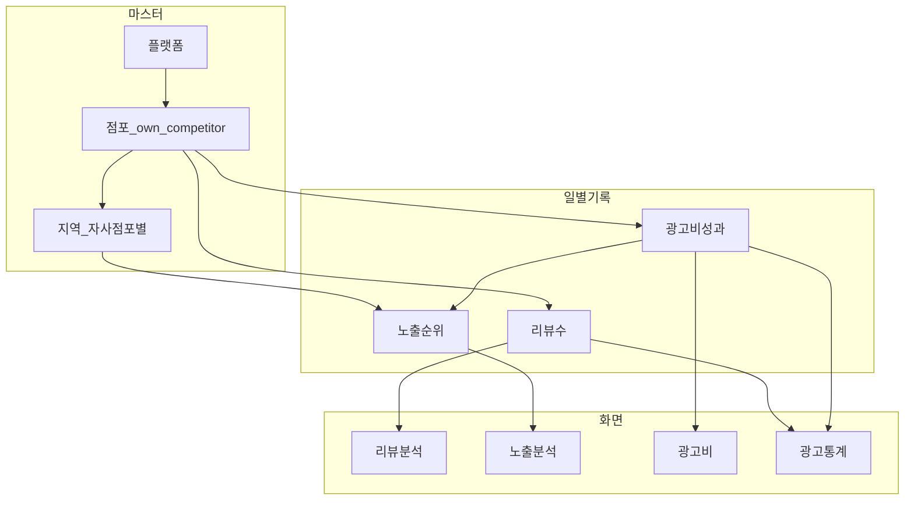

# 광고 관리 전체 기획 · 재구현 스펙 (SKADI `64/ads`)

SKADI `64/ads/` 의 **리뷰분석 · 노출분석 · 광고비 · 광고통계** 전체를 분석해,  
독립 Next.js 앱에서 **기능 누락 없이** 다시 만들기 위한 문서다.

원본:

| 경로 | 역할 |
|------|------|
| `64/ads/index.php` | 리뷰분석 |
| `64/ads/exposure.php` | 노출분석 |
| `64/ads/ad_cost.php` | 광고비관리 |
| `64/ads/statistics.php` | 광고통계 (Chart.js) |
| `64/ads/ads_api.php` | 통합 API |
| `64/ads/create_ads_tables.sql` | 플랫폼·점포·리뷰·광고비·캠페인 |
| `64/ads/create_exposure_tables.sql` | 지역·노출순위 |
| `64/ads/add_memo_column.sql` | 광고비 `memo` |
| `64/ads/ads.md` | 초기 기획 메모 |

메뉴(헤더): 리뷰분석 / 노출분석 / 광고비 / 광고통계

---

## 1. 제품 목적

배달 플랫폼(배민·쿠팡이츠 등)에서:

1. **자사 vs 경쟁사 리뷰수**를 매일 기록 → 일별 증감·월 성장 비교  
2. **지역별 노출 순위**(신규/재구매)를 매일 기록 → 순위 히트맵  
3. **자사 광고비·성과**(노출/클릭/주문/매출) 기록 → CTR·CVR·CPC·CPA·ROAS  
4. 월 단위 **요약 카드 + 차트**로 한눈에 보기  

권한 (Next): **사장 · 지점장**만. 데이터는 **세션 지점 범위**로 격리.  
(원본 SKADI는 점포명으로 송파/야탑을 구분하고 **branch_id 없음** → Next에서는 `branchId` 필수.)



---

## 2. 화면 4종 (필수)

| 라우트 (Next 제안) | 원본 | 핵심 |
|--------------------|------|------|
| `/ads` 또는 `/ads/reviews` | `index.php` | 월 달력형 리뷰 매트릭스 |
| `/ads/exposure` | `exposure.php` | 지역×일자 순위 + CPC/메모/시간 행 |
| `/ads/costs` | `ad_cost.php` | 일별 광고비 CRUD + 월 합계 |
| `/ads/statistics` | `statistics.php` | 카드 + Chart.js 4종 |

공통 UX:

- 이전달 / 다음달 네비
- 플랫폼 필터 (전체 가능)
- 로딩·토스트
- 모달 CRUD

---

## 3. 데이터 모델 (전부)

### 3.1 `ad_platforms` (원본 `64_ad_platforms`)

| 필드 | 설명 |
|------|------|
| id | PK |
| name | 배달의민족, 쿠팡이츠 |
| code | unique (`baemin`, `coupang`) |
| colorCode | UI 색 (`#2AC1BC`, `#E31837`) |
| icon | (선택) FA 아이콘명 |
| sortOrder, isActive | |

시드: 배민, 쿠팡이츠.

### 3.2 `ad_stores` (원본 `64_ad_stores`)

| 필드 | 설명 |
|------|------|
| id | PK |
| **branchId** | Next 필수 (원본엔 없음) |
| platformId | FK |
| name | 점포명 (예: 송파, 분당야탑, 경쟁사명) |
| storeType | `OWN` \| `COMPETITOR` |
| address, notes | |
| sortOrder, isActive | |

**동일 상호라도 플랫폼마다 점포 행이 따로** 있다 (배민-송파 / 쿠팡-송파).

### 3.3 `ad_reviews` (원본 `64_ad_reviews`)

| 필드 | 설명 |
|------|------|
| storeId + reviewDate | **UNIQUE** |
| reviewCount | 누적 총 리뷰수 (일별 스냅샷) |
| ratingAvg | 선택 평점 |
| notes | |

일별 증감 = 당일 count − 직전 기록 count (전월 말일 포함).

### 3.4 `ad_costs` (원본 `64_ad_costs` + memo/check_time)

| 필드 | 설명 |
|------|------|
| branchId | Next 필수 |
| platformId, storeId | FK (자사 점포 위주) |
| costDate | |
| adSpend, impressions, clicks, orders, orderAmount | 입력 |
| ctr, cvr, cpc, cpa, roas | **저장 시 계산** |
| notes | 긴 비고 |
| **memo** | 짧은 메모 **최대 5글자** (노출분석 셀용) |
| **checkTime** | 확인 시간 문자열 최대 10자 (예: `14:30`) |
| UNIQUE(storeId, costDate) | 원본 기준 (platform은 store에 묶임) |

노출분석에서 memo/time만 있어도 `ad_costs` 행을 **부분 INSERT** 할 수 있다.

### 3.5 `ad_regions` (원본 `64_ad_regions`)

| 필드 | 설명 |
|------|------|
| storeId | **자사 점포**에만 연결 |
| regionName | 동 단위 (일원동, 야탑1동 …) |
| UNIQUE(storeId, regionName) | |
| soft delete: isActive=0 | |

원본 시드 예시: 송파·분당야탑 × 배민·쿠팡 각각 8개 동.

### 3.6 `ad_exposures` (원본 `64_ad_exposure`)

| 필드 | 설명 |
|------|------|
| regionId, platformId | |
| exposureDate | |
| orderType | `NEW` \| `REPEAT` (신규 / 재구매) |
| rank | 정수, **0 = 노출 안 됨** |
| UNIQUE(regionId, platformId, exposureDate, orderType) | |

### 3.7 `ad_campaigns` (원본 테이블만 존재)

스키마만 있고 **UI·API 미구현**. 1차 범위 밖으로 두고, 스키마는 선택 이식.

---

## 4. 지표 공식 (광고비)

입력: `adSpend`, `impressions`, `clicks`, `orders`, `orderAmount`

```text
CTR  (%) = impressions > 0 ? clicks / impressions * 100 : 0
CVR  (%) = clicks > 0      ? orders / clicks * 100       : 0
CPC  (원) = clicks > 0      ? round(adSpend / clicks)     : 0
CPA  (원) = orders > 0      ? round(adSpend / orders)     : 0
ROAS (%) = adSpend > 0     ? orderAmount / adSpend * 100 : 0
```

- 화면 입력 모달에서 **실시간 미리보기**
- 저장 시 DB에 동일 값 persist
- ROAS ≥ 100 → 긍정(초록), 미만 → 부정(빨강) 표시 (원본 UI)

월 합계 summary도 동일 공식으로 합산 후 재계산 (`avg_ctr`, `avg_cvr`, `avg_cpc`, `avg_cpa`, `total_roas`).

---

## 5. 기능 상세 — 리뷰분석 (`/ads/reviews`)

### 5.1 UI

- 월 네비
- 필터: 플랫폼 / 점포유형(전체·자사·경쟁사)
- 버튼: **리뷰수 입력**(메인), 점포추가, 플랫폼추가
- 본문: **플랫폼별 테이블** 분리
  - 행 = 점포 (자사 행 배경 파란 톤, 경쟁사 회색)
  - 열 = 일자 1…N (토=노랑, 일=빨강 톤)
  - 셀: `23123 (+21)` 형태 — 총리뷰 + 일별증감(+/− 색)
- sticky 점포명 열, 가로 스크롤

### 5.2 모달

1. **점포 추가/수정** — 플랫폼, 점포명, 유형(own/competitor), 주소, 비고  
2. **플랫폼 추가** — name, code, color, icon  
3. **리뷰수 입력** — 날짜(기본 오늘) + **활성 점포 전체 일괄 입력** (`bulk_add_reviews`)  
   - 점포별 review_count, (선택) rating_avg  
   - upsert by (storeId, date)

### 5.3 API

| action | 설명 |
|--------|------|
| get_platforms / add / update / delete | 플랫폼 CRUD (delete=비활성) |
| get_stores / get_store / add / update / delete | 점포 |
| get_review_list | 월 매트릭스용 stores + review_map + prev_data |
| get_reviews | 단순 목록 |
| add_review / update / delete | 단건 |
| bulk_add_reviews | 일자 일괄 |

### 5.4 증감 계산

- 같은 달 이전 일자 값이 있으면 그 차이  
- 1일이면 전월 마지막 기록(`prev_data`)과 비교  
- 데이터 없으면 증감 표시 생략 가능

---

## 6. 기능 상세 — 노출분석 (`/ads/exposure`)

### 6.1 UI

- 월 네비
- 필터: 플랫폼 / 점포 / **주문유형(신규·재구매)**
- 버튼: **노출순위 입력**, 지역관리
- 본문: **자사 점포 × 플랫폼** 섹션
  - 행1: **CPC** (해당일 `ad_costs.cpc` 표시, 클릭 가능하면 광고비 연동)
  - 행2: **메모** (5글자, 클릭 → memo 모달 → `save_ad_memo`)
  - 행3: **시간** (check_time, 클릭 → 시간 모달 → `save_ad_time`)
  - 이후 행: **지역별 순위**  
    - rank 색: 좋음(초록) / 중간(노랑) / 나쁨(빨강) / 0·없음(회색)  
    - 예: 1~3 good, 4~10 mid, 11+ bad (원본 클래스 `rank-good|mid|bad|none` — 구현 시 동일 임계값 맞출 것)

### 6.2 모달

1. **노출순위 입력** — 날짜 + 주문유형 고정, 지역 목록에 rank 일괄 → `bulk_save_exposure`  
2. **지역 관리** — 점포 선택 후 지역 추가/비활성 삭제  
3. **메모** — max 5자  
4. **시간** — max 10자 (예: `14:30`, `오후2시`)

### 6.3 API

| action | 설명 |
|--------|------|
| get_regions / add_region / delete_region | 지역 (soft delete) |
| get_exposure_data | regions + exposure_map + cpc_map + memo_map + time_map |
| save_exposure | 단건 upsert |
| bulk_save_exposure | 일자 일괄 |
| save_ad_memo | ad_costs.memo upsert |
| save_ad_time | ad_costs.check_time upsert |

노출 조회는 **store_type = own** 지역만.

---

## 7. 기능 상세 — 광고비 (`/ads/costs`)

### 7.1 UI

- 월 네비
- 필터: 플랫폼 / 점포(자사)
- 버튼: 광고비 입력
- **요약 카드**: 광고지출합, 노출합, 클릭합, 주문합, 주문금액합, CTR/CVR/CPC/CPA/ROAS  
- **테이블 컬럼**: 날짜, 점포, 플랫폼, 광고지출, 노출, 클릭, 주문, 주문금액, CTR, CVR, CPC, ROAS, 관리(수정/삭제)  
- 0원·전부 0인 행은 목록에서 제외 (원본 SQL 조건)

### 7.2 모달 입력

- 플랫폼(기본 배민), 점포(own), 날짜(오늘)
- ad_spend, impressions, clicks, orders, order_amount, notes
- 입력 중 `calculateMetrics()` 실시간 표시
- 저장 시 지표 재계산 후 INSERT/UPDATE (점포+날짜 unique)

### 7.3 API

| action | 설명 |
|--------|------|
| get_ad_costs | costs + summary |
| get_ad_cost | 단건 |
| add_ad_cost / update_ad_cost / delete_ad_cost | CRUD |

점포 목록은 `store_type=own` 필터로 로드.

---

## 8. 기능 상세 — 광고통계 (`/ads/statistics`)

Chart.js 사용 (Next: `recharts` / `chart.js` 중 택1).

### 8.1 요약 카드

월 단위 합계·평균 (광고비·리뷰 성장 등) — `get_ad_stats` / `get_review_stats` 조합.

### 8.2 차트 4종 (원본 그대로)

1. **점포별 월간 리뷰 증감** — bar (`get_review_stats`: end−start count)  
2. **플랫폼별 광고비 현황** — bar/doughnut (`get_ad_stats` spend)  
3. **플랫폼별 ROAS 비교** — bar  
4. **일별 광고비 추이** — line (`get_ad_costs` 일자별 합 또는 별도 집계)

### 8.3 추가 API

| action | 설명 |
|--------|------|
| get_review_stats | 점포별 min/max/growth/avg_rating/data_days |
| get_ad_stats | 점포×플랫폼 월 합 + 효율 |
| get_monthly_summary | 연간 월별 ad_trend + own store review_trend |

하단 테이블: 점포별 리뷰 성장 순위, 광고 ROAS 순위 등 (원본 statistics.php 본문과 동일하게 이식).

---

## 9. API 전체 목록 (재구현 체크)

### 플랫폼
- [ ] get_platforms  
- [ ] add_platform / update_platform / delete_platform  

### 점포
- [ ] get_stores (?store_type=&platform_id=&branch_id=)  
- [ ] get_store  
- [ ] add_store / update_store / delete_store  

### 리뷰
- [ ] get_review_list (매트릭스)  
- [ ] get_reviews  
- [ ] add_review / update_review / delete_review  
- [ ] bulk_add_reviews  

### 광고비
- [ ] get_ad_costs (+ summary)  
- [ ] get_ad_cost  
- [ ] add_ad_cost / update_ad_cost / delete_ad_cost  
- [ ] save_ad_memo / save_ad_time  

### 노출
- [ ] get_regions / add_region / delete_region  
- [ ] get_exposure_data  
- [ ] save_exposure / bulk_save_exposure  

### 통계
- [ ] get_review_stats  
- [ ] get_ad_stats  
- [ ] get_monthly_summary  

모든 쓰기·읽기에 **branchIds 가드** (사장 배정 / 지점장 소속).

---

## 10. Next.js 권한 · 지점 설계

| 역할 | 접근 |
|------|------|
| OWNER | 배정 지점 전환 후 전 메뉴 |
| MANAGER | 자기 지점만 |
| STAFF / PARTTIME | 광고 메뉴 없음 (미들웨어 차단) |

마스터 데이터:

- 플랫폼은 **전역** (전 지점 공유) 또는 지점 무관 시드  
- 점포·리뷰·광고비·지역·노출은 **branchId** 스코프  

원본 송파/야탑 시드 지역은 지점 생성 시 **템플릿으로 복사**하거나 관리자가 수동 추가.

---

## 11. Prisma 매핑 제안

기존 `yuksa-64` 스키마의 `AdPlatform`, `AdStore`, `AdReview`, `AdCost`, `AdExposure` 를 확장:

```text
AdCost        + memo String? @db.VarChar(10)
              + checkTime String? @map("check_time") @db.VarChar(10)
AdRegion      신규 (storeId, regionName, sortOrder, isActive)
AdExposure    regionId + platformId + orderType(NEW|REPEAT) + rank
              UNIQUE(regionId, platformId, exposureDate, orderType)
AdStore       branchId 유지, storeType OWN|COMPETITOR
```

캠페인 테이블은 Phase 2.

---

## 12. 구현 순서 (권장)

### Phase 1 — 마스터 + 리뷰
1. 플랫폼·점포 CRUD  
2. 리뷰 단건/벌크 + 월 매트릭스 UI  
3. 일별 증감 표시  

### Phase 2 — 광고비
1. 지표 계산 유틸  
2. CRUD + 월 요약 카드·테이블  

### Phase 3 — 노출
1. 지역 CRUD  
2. 순위 벌크 입력 + 히트맵 테이블  
3. memo / check_time / CPC 행 (ad_costs 연동)  

### Phase 4 — 통계
1. review/ad/monthly API  
2. 차트 4종 + 순위 테이블  

### Phase 5 — 폴리시
1. 지점 스코프·권한  
2. 시드(배민/쿠팡 + 샘플 지역 템플릿)  

---

## 13. UX 디테일 체크리스트

- [ ] 주말/일요일 열 색 구분  
- [ ] 자사/경쟁사 행 배경 구분  
- [ ] sticky 첫 열 (점포명·지역명)  
- [ ] 리뷰 셀 `count (+delta)` / `count (-delta)`  
- [ ] 순위 0 = 회색 “안보임”  
- [ ] 메모 5자·시간 10자 제한  
- [ ] 광고비 모달 실시간 CTR~ROAS  
- [ ] ROAS 100% 기준 색  
- [ ] 빈 점포/지역 시 CTA (“첫 점포 추가”, “지역 추가”)  
- [ ] upsert로 같은 날짜 재입력 시 덮어쓰기  

---

## 14. 원본 vs Next 차이

| 항목 | SKADI 원본 | Next 독립앱 |
|------|------------|-------------|
| 인증 | members role 64/admin | employees OWNER/MANAGER |
| 지점 | 점포명으로 사실상 구분 | `branchId` 명시 |
| DB | MySQL `64_*` | Postgres Prisma |
| 캠페인 | 테이블만 | 1차 제외 |
| 통계 라이브러리 | Chart.js CDN | 팀 선택 |

데이터 이관은 선택. 이관 시 store·platform code로 매핑 후 branch 할당.

---

## 15. 검증 시나리오

1. 플랫폼 2개·자사 1·경쟁사 2 등록  
2. 오늘 리뷰 일괄 입력 → 매트릭스·증감 확인  
3. 광고비 입력 → CTR/ROAS 저장값 = 화면 계산  
4. 지역 8개 + 신규/재구매 순위 벌크 → 색 구분  
5. 노출 화면에서 메모·시간 저장 → ad_costs 부분 행 생성  
6. 통계 월 차트·카드 숫자 = costs/reviews 합과 일치  
7. 다른 지점 ID로 API 호출 시 403  

---

## 변경 이력

| 날짜 | 내용 |
|------|------|
| 2026-03-25 | `64/ads` 4화면·전 API·스키마·지표·Next 이식 기획 정리 |
