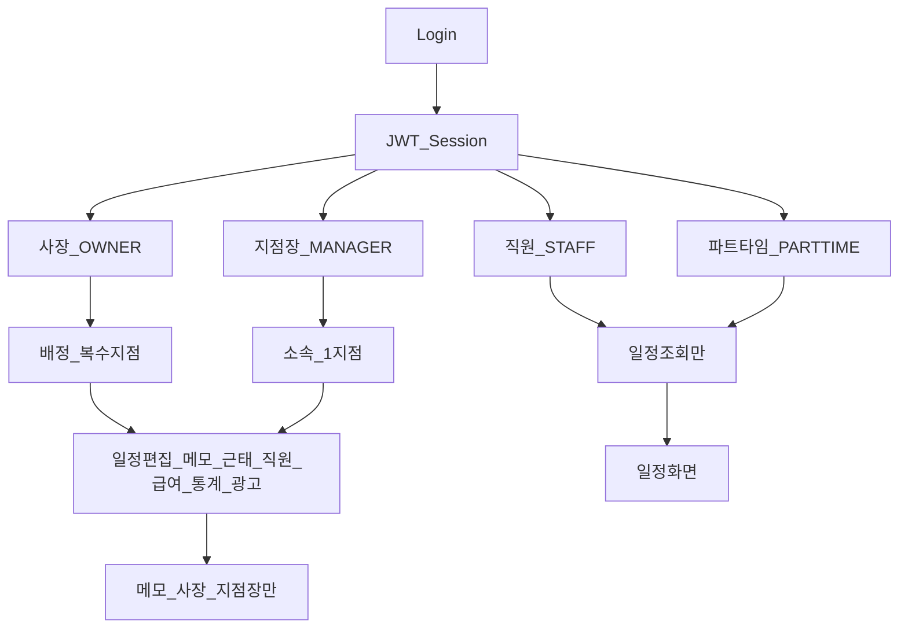

# 육사 64 독립 사이트 — 전체 구조 및 개발 가이드

SKADI PHP(`/64`)와 분리된 Next.js 관리 앱입니다.  
이 문서는 폴더 구조, 권한 모델, 데이터, API, 화면, 로컬/배포 개발 순서를 한곳에 정리합니다.

관련 문서:

- [README.md](../README.md) — 빠른 시작
- [DEPLOY.md](../DEPLOY.md) — Vercel · Neon · 도메인
- [PAYROLL_CREATE_PRINT_SPEC.md](./PAYROLL_CREATE_PRINT_SPEC.md) — 급여대장 생성·A4 인쇄·지급 양식 (SKADI 원본 분석)
- [ADS_SPEC.md](./ADS_SPEC.md) — 리뷰·노출·광고비·광고통계 전체 기획 (SKADI `64/ads`)
- [prisma/schema.prisma](../prisma/schema.prisma) — DB 스키마 원본

---

## 1. 한눈에 보기

| 항목 | 내용 |
|------|------|
| 앱 이름 | 육식사관학교 관리 |
| 저장소 | https://github.com/kronosyw/64 |
| 로컬 경로 | `.../dev/yuksa-64` |
| 프레임워크 | Next.js App Router (TypeScript) |
| 호스팅 | Vercel |
| DB | PostgreSQL (Neon / Prisma Postgres) |
| ORM | Prisma 6 |
| 인증 | Auth.js (next-auth v5) Credentials + bcrypt |
| UI | Tailwind CSS 4 |

SKADI `members` 로그인·MySQL(`employees`, `64_branches` 등)과 **연결하지 않습니다.**

---

## 2. 시스템 구조

```text
브라우저
  └─ Next.js (Vercel)
       ├─ middleware.ts          로그인·역할 라우트 가드
       ├─ app/* (페이지)
       ├─ app/api/* (API Route)
       ├─ lib/auth.ts            세션 (employeeId, role, branchIds)
       └─ Prisma Client
            └─ PostgreSQL (Neon)
```



---

## 3. 디렉터리 구조

```text
yuksa-64/
├── prisma/
│   ├── schema.prisma          # 모델·enum
│   ├── seed.ts                # 사장·본점·광고 플랫폼 시드
│   └── migrations/            # migrate 이력
├── src/
│   ├── middleware.ts          # 미로그인 차단, 역할별 경로 제한
│   ├── app/
│   │   ├── layout.tsx         # 루트 레이아웃 + SessionProvider
│   │   ├── page.tsx           # 일정 (홈)
│   │   ├── login/             # 로그인
│   │   ├── branches/          # 지점 (사장만)
│   │   ├── employees/         # 직원·계정
│   │   ├── attendance/        # 근태
│   │   ├── payroll/           # 급여대장
│   │   ├── statistics/        # 근무 통계
│   │   ├── ads/               # 광고
│   │   ├── account/password/  # 비밀번호 변경
│   │   └── api/
│   │       ├── auth/[...nextauth]/
│   │       ├── branches/
│   │       ├── employees/
│   │       ├── schedules/
│   │       ├── memos/
│   │       ├── attendance/
│   │       ├── payroll/
│   │       ├── statistics/
│   │       ├── ads/
│   │       └── account/password/
│   ├── components/            # UI (AppShell, ScheduleBoard 등)
│   └── lib/
│       ├── auth.ts            # Auth.js 설정
│       ├── session.ts         # 서버 페이지용 세션 헬퍼
│       ├── api.ts             # API 권한·응답 헬퍼
│       ├── roles.ts           # 역할 라벨·권한 함수
│       ├── employees.ts       # 직원 생성·사장-지점 N:M 배정
│       ├── payroll.ts         # 급여 계산
│       └── prisma.ts          # Prisma 싱글톤
├── docs/
│   └── ARCHITECTURE_AND_DEV_GUIDE.md  # 본 문서
├── .env.example
├── DEPLOY.md
├── vercel.json
└── package.json
```

---

## 4. 역할 · 권한 매트릭스

| 기능 | 사장 | 지점장 | 직원 | 파트타임 |
|------|:----:|:------:|:----:|:--------:|
| 로그인 | O | O | O | O |
| 일정 조회 (자기 접근 지점) | O | O | O | O |
| 일정 등록/수정/삭제 | O | O | X | X |
| 일정 아래 메모 | O | O | X | X |
| 지점 전환 UI | O (배정 지점) | X (고정) | X | X |
| 지점 등록/수정/비활성 | O | X | X | X |
| 사장 계정 생성 | O (여러 명, 지점 배정) | X | X | X |
| 직원·파트타임 계정 | O | O (자기 지점만) | X | X |
| 근태 / 급여 / 통계 / 광고 | O | O | X | X |
| 비밀번호 변경 | O | O | O | O |

서버에서 반드시 지키는 규칙:

1. 세션 `branchIds` 밖의 지점 ID는 쿼리스트링으로도 우회 불가 (`ensureBranch` / `parseBranchId`).
2. 사장은 여러 명 가능. 각자 다른 지점을 갖거나, 같은 지점을 동업으로 공유할 수 있다 (`employee_branches`).
3. 사장 소속은 `employee_branches` N:M, 그 외는 `employees.branch_id` 1개.
4. `RESIGNED`(퇴사) 계정은 로그인 불가.
5. 메모 API는 사장·지점장만 (`requireApiMemo`).

---

## 5. 데이터 모델 요약

### 핵심 테이블

| 모델 (테이블) | 설명 |
|---------------|------|
| `Branch` (`branches`) | 지점 |
| `Employee` (`employees`) | 직원 + `login_id` / `password_hash` / `role` |
| `EmployeeBranch` (`employee_branches`) | 사장 ↔ 지점 N:M |
| `Schedule` (`schedules`) | 일별 근무 일정 |
| `Memo` (`memos`) | 지점 메모·답글 |
| `Attendance` (`attendances`) | 근태 |
| `Payroll` / `PayrollItem` | 급여대장 헤더·항목 |
| `AdPlatform` / `AdStore` / `AdReview` / `AdCost` / `AdExposure` | 광고 |

### Role enum

| DB | 화면 |
|----|------|
| `OWNER` | 사장 |
| `MANAGER` | 지점장 |
| `STAFF` | 직원 |
| `PARTTIME` | 파트타임 |

### WorkType enum

| DB | 화면 |
|----|------|
| `OPEN` | 오픈 |
| `CLOSE` | 마감 |
| `OPEN_CLOSE` | 오픈마감 |
| `EVENING_PT` | 저녁PT |
| `FULL_PT` | 풀타임PT |
| `OFF` | 휴무 |

스키마 변경 시:

```bash
npx prisma migrate dev --name <변경요약>
npx prisma generate
```

---

## 6. 인증 · 세션

- Provider: Credentials (`loginId` + `password`)
- 세션 전략: JWT
- 세션 필드: `id`(employeeId), `name`, `role`, `branchIds`, `loginId`
- 로그인 페이지: `/login` (SKADI `/login.php`와 무관)
- 미들웨어: 미로그인 → `/login`, 직원·파트타임의 ops 경로 차단

주요 파일:

- `src/lib/auth.ts`
- `src/app/api/auth/[...nextauth]/route.ts`
- `src/middleware.ts`

환경 변수:

| 변수 | 용도 |
|------|------|
| `DATABASE_URL` | Postgres 연결 |
| `AUTH_SECRET` | JWT 서명 (`openssl rand -base64 32`) |
| `AUTH_TRUST_HOST` | Vercel에서 `true` |
| `AUTH_URL` | 배포 도메인 (선택) |
| `SEED_*` | 시드 사장/지점 |

---

## 7. API 목록

공통 응답: `{ success: boolean, message?: string, ... }`  
권한 실패: `401` / `403`

| Method | Path | 권한 | 설명 |
|--------|------|------|------|
| * | `/api/auth/*` | 공개(로그인) | Auth.js |
| GET/POST/PATCH/DELETE | `/api/branches` | 조회: 사장·지점장 / 쓰기: 사장 | 지점 |
| GET/POST/PATCH | `/api/employees` | 사장·지점장 | 직원·계정 |
| GET/POST/PATCH/DELETE | `/api/schedules` | 조회: 전원 / 쓰기: 사장·지점장 | 일정 |
| GET/POST/PATCH/DELETE | `/api/memos` | 사장·지점장 | 메모 |
| GET/POST/DELETE | `/api/attendance` | 사장·지점장 | 근태 |
| GET/POST/PATCH | `/api/payroll` | 사장·지점장 | 급여 |
| GET | `/api/statistics` | 사장·지점장 | 통계 |
| GET/POST | `/api/ads` | 사장·지점장 | 광고 |
| POST | `/api/account/password` | 로그인 사용자 | 비밀번호 변경 |

API 헬퍼: `src/lib/api.ts`

- `requireApiSession` / `requireApiOps` / `requireApiOwner` / `requireApiMemo`
- `ensureBranch(session.branchIds, branchId)`

---

## 8. 화면 라우트

| Path | 대상 | 설명 |
|------|------|------|
| `/login` | 전원 | 아이디·비밀번호 |
| `/` | 전원 | 월 일정 + (권한 시) 메모 |
| `/branches` | 사장 | 지점 목록·등록 |
| `/employees` | 사장·지점장 | 계정 등록·목록 |
| `/attendance` | 사장·지점장 | 근태 |
| `/payroll` | 사장·지점장 | 급여대장 생성·조회 |
| `/statistics` | 사장·지점장 | 월 근무 집계 |
| `/ads` | 사장·지점장 | 점포·광고비·리뷰/노출 |
| `/account/password` | 전원 | 비밀번호 변경 |

홈 일정은 `?branchId=&year=&month=` 로 필터합니다.  
`branchId`는 세션 `branchIds` 안에서만 유효합니다.

---

## 9. 로컬 개발 가이드

### 9.1 최초 셋업

```bash
cd yuksa-64
cp .env.example .env
# DATABASE_URL, AUTH_SECRET 채우기

npm install
npx prisma migrate dev
npm run db:seed
npm run dev
```

브라우저: http://localhost:3000  
시드 기본 계정: `owner` / `change-me-now` (`.env`의 `SEED_*`로 변경 가능)

### 9.2 자주 쓰는 스크립트

| 스크립트 | 설명 |
|----------|------|
| `npm run dev` | 개발 서버 |
| `npm run build` | 프로덕션 빌드 |
| `npm run db:generate` | Prisma Client 생성 |
| `npm run db:migrate` | 개발 마이그레이션 |
| `npm run db:deploy` | 배포 DB에 migrate |
| `npm run db:seed` | 시드 실행 |

### 9.3 기능 추가 순서 (권장)

1. `prisma/schema.prisma` 모델 추가 → `migrate`
2. `src/lib/*` 에 도메인 규칙 (권한·계산)
3. `src/app/api/.../route.ts` 작성 (`requireApi*` + `ensureBranch`)
4. `src/app/.../page.tsx` UI
5. 필요 시 `middleware.ts` 경로 가드 추가
6. `npm run build` 로 타입·프리렌더 확인

### 9.4 코딩 규칙

- **권한은 UI만으로 끝내지 말 것.** API에서 다시 검사.
- 지점 범위는 항상 `session.user.branchIds` 기준.
- Client Component에서 `new Date()`를 초기 state에 넣지 말 것 (Next 16 prerender). `useEffect`에서 설정.
- `cacheComponents`는 현재 `false` (`next.config.ts`). 함부로 켜면 auth/DB 페이지 빌드가 깨질 수 있음.
- 비밀값(`.env`)은 커밋 금지. `.env.example`만 공유.

### 9.5 사장 · 지점 배정 구현 위치

- 사장 생성·지점 배정: `src/lib/employees.ts` → `createEmployeeAccount` / `updateOwnerBranches`
- 배정 저장: `EmployeeBranch` (사장↔지점 N:M, 동업 가능)
- 로그인 시 지점 목록: `src/lib/auth.ts` → `resolveBranchIds`

---

## 10. 배포 개발 가이드

상세 절차는 [DEPLOY.md](../DEPLOY.md).

요약:

1. Neon(또는 Vercel Postgres) 생성 → `DATABASE_URL`
2. Vercel에 GitHub 저장소 연결
3. Env: `DATABASE_URL`, `AUTH_SECRET`, `AUTH_TRUST_HOST=true`
4. Build: `prisma generate && next build`
5. `prisma migrate deploy` + `db:seed` (production URL로 1회)
6. 도메인 연결 후 `AUTH_URL` 설정

`vercel.json` 리전: `icn1` (서울).

---

## 11. SKADI와의 관계

| | SKADI `/64` | 본 앱 |
|--|-------------|--------|
| 위치 | skadi admin 모노리포 | 독립 레포 `yuksa-64` |
| 로그인 | `members` + `/login.php` | `employees.login_id` |
| DB | MySQL 공유 | Neon Postgres 전용 |
| 역할 | `admin` / `64` | OWNER/MANAGER/STAFF/PARTTIME |

이관 범위 밖 (1차):

- 기존 일정·직원 데이터 마이그레이션
- 면접(interview) 메뉴
- 양식 HTML 정적 페이지

필요 시 별도 ETL로 `schedules` / `employees` 매핑 후 비밀번호 **재발급** (원본에 로그인 비번 없음).

---

## 12. 체크리스트 (신규 기여자)

- [ ] `.env` 설정 후 `migrate` + `seed` 성공
- [ ] `owner` 로그인 → 지점·직원 메뉴 보임
- [ ] 직원/파트타임 계정 생성 후 일정만 보이고 메모 없음
- [ ] 다른 지점 `branchId`로 API 호출 시 403
- [ ] 사장 여러 명 등록·같은 지점 동업 배정 확인
- [ ] `npm run build` 통과

---

## 13. 변경 이력 (문서)

| 날짜 | 내용 |
|------|------|
| 2026-03-24 | 초기 독립 앱 구조·권한·API·개발/배포 가이드 작성 |
